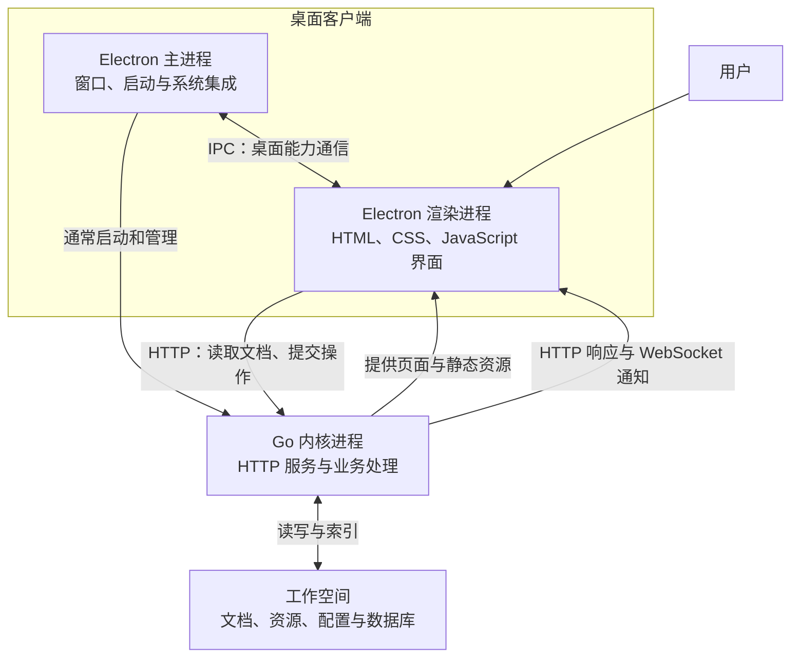
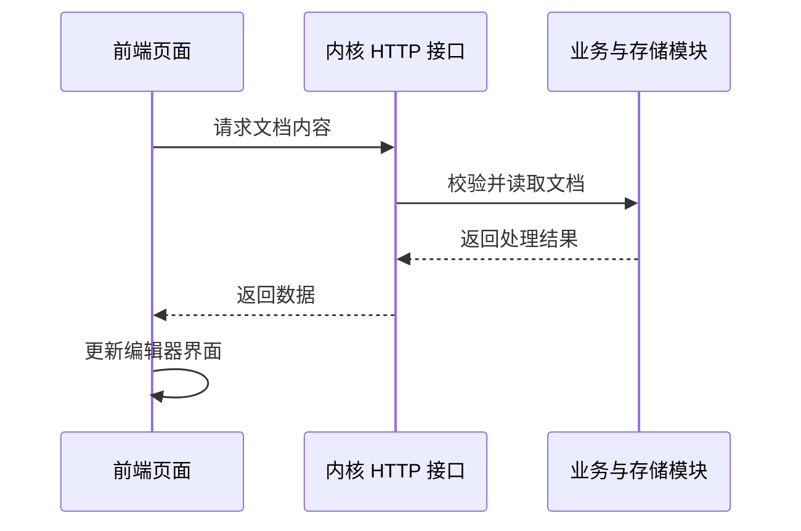

# 01：项目总架构

依据：当前仓库源码，整理于 2026-10-14。本文介绍主要结构；同步、加密、插件和移动端细节留待后续专题。

## 先校准一个概念

思源包含一个用 Go 编写并编译成可执行文件的应用内核。Windows 下通常叫 `SiYuan-Kernel.exe`。用户运行的是这个程序，使用发布版不需要安装 Go；从源码编译它才需要 Go 工具链。这里的“内核”指负责数据和业务的后台服务，不是操作系统内核。

界面主要使用 TypeScript、HTML 模板和 SCSS。TypeScript 编译为 JavaScript，SCSS 编译为 CSS，最终由浏览器引擎渲染。Electron 提供桌面窗口和系统集成，Go 内核负责文档、搜索、存储等业务。

## 桌面端总架构图

这是主要关系的简化图。Electron 主进程也会调用内核接口；页面里的部分操作先更新本地界面，再通过异步流程与内核协调。

## 三个部分各自做什么

| 部分 | 主要职责 | 源码入口 |
|---|---|---|
| Electron 主进程 | 创建窗口、管理应用生命周期、启动内核、对接桌面能力 | [app/electron/main.js](../../app/electron/main.js) |
| 前端页面 | 显示笔记、处理用户输入、编辑区块、调用内核接口 | [app/src/index.ts](../../app/src/index.ts)、[app/src/protyle/](../../app/src/protyle/) |
| Go 内核 | 提供 HTTP 服务，处理文档、搜索、数据库、历史、同步等业务 | [kernel/main.go](../../kernel/main.go)、[kernel/cli/cmd/serve.go](../../kernel/cli/cmd/serve.go) |

Electron 有主进程和渲染进程之分：主进程管理窗口，渲染进程运行窗口中的页面。Go 内核是另一个进程，通过本地服务与前端协作。

可以把它理解为桌面程序内部运行了一套前后端：页面向本机后台请求数据，后台把结果交给页面。这套分工也允许浏览器直接访问内核提供的界面。

## 页面如何与内核通信

### HTTP：请求与响应

例如打开文档，页面需要向内核请求文档内容，内核读取和处理数据后返回结果，页面再显示出来。主要入口是前端的 [fetch.ts](../../app/src/util/fetch.ts) 与内核的 [router.go](../../kernel/api/router.go)。

这张图展示通信概念，具体打开文档的完整调用链将在下一部分追踪。当前可确认的文档接口之一是 `/api/filetree/getDoc`。

### WebSocket：持续通知

HTTP 通常由页面发起请求；WebSocket 建立持续连接，使内核可以主动通知页面状态变化。前端连接代码在 [app/src/layout/Model.ts](../../app/src/layout/Model.ts)，使用 `/ws` 路径。

### IPC：Electron 内部通信

IPC 是 Electron 主进程与渲染进程之间的通信机制，用于页面与桌面能力协作。它与页面向 Go 内核发出的 HTTP 请求是两条不同的通信路径。

## 前端源码与编译产物

| 内容 | 位置 | 作用 |
|---|---|---|
| TypeScript | `app/src/` | 界面逻辑、事件处理与接口调用 |
| HTML 模板 | `app/src/assets/template/` | 页面结构模板，界面也会由代码动态生成 |
| SCSS | `app/src/assets/scss/` | 界面样式 |
| Electron 页面产物 | `app/stage/build/app/` | 在 Electron 窗口中运行 |
| 桌面浏览器页面产物 | `app/stage/build/desktop/` | 在普通浏览器中运行 |
| 移动页面产物 | `app/stage/build/mobile/` | 移动端界面 |
| 导出渲染产物 | `app/stage/build/export/` | 导出内容的渲染库 |

Webpack 根据不同配置将源码编译到这些目录。Electron 与桌面浏览器构建共用 `app/src/index.ts` 入口，但通过构建配置和条件编译适配环境；移动端有自己的入口与交互实现。

构建配置可从 [webpack.config.js](../../app/webpack.config.js)、[webpack.desktop.js](../../app/webpack.desktop.js)、[webpack.mobile.js](../../app/webpack.mobile.js) 和 [webpack.export.js](../../app/webpack.export.js) 查阅。编译产物不作为手工修改入口。

## 笔记存在哪里

“源码仓库”保存程序代码，“工作空间”保存用户数据。它们职责不同，用户工作空间可以位于仓库之外。

普通笔记本的文档以 `.sy` 文件保存，内容模型是结构化的区块树，并非简单的 Markdown 文本文件。资源放在工作空间的 `data/assets/`，偏好数据的一部分放在 `data/storage/`。内核还维护 SQLite 数据库和索引，支持搜索及其他查询。

加密笔记本具有独立的加密读写和索引约束，不能把所有 `.sy` 文件都当作可直接读取的明文 JSON，也不能把数据库简单视为全部原始笔记。格式细节以 [SY-FORMAT.md](../../docs/SY-FORMAT.md) 和 [加密笔记本说明](../../docs/ENCRYPTED-NOTEBOOK.zh-CN.md) 为准。

## 内核的目录地图

先认识分工即可，不需要立即阅读所有文件。

| 目录 | 可以先怎样理解 |
|---|---|
| `kernel/cli/cmd/` | 程序命令入口，`serve` 用于启动服务 |
| `kernel/server/` | HTTP 服务、静态页面和通信基础设施 |
| `kernel/api/` | 接收 HTTP 请求并调用业务逻辑 |
| `kernel/apicontract/` | API 输入输出与兼容规则的契约定义 |
| `kernel/model/` | 文档、搜索、历史、同步等核心业务 |
| `kernel/treenode/` | 文档区块树及其关联结构 |
| `kernel/filesys/` | 文档文件读写 |
| `kernel/sql/` | SQLite 数据库及索引处理 |
| `kernel/av/` | 属性视图，也就是数据库功能的业务实现 |

## 为什么启动命令不止一个

源码开发中，“编译页面”“运行后台”“打开窗口”是三个动作。

| 动作 | 常见命令 | 结果 |
|---|---|---|
| 编译并监听前端变化 | `pnpm run dev` | 生成 Electron 页面资源并持续监听源码 |
| 启动后台 | `pnpm run start:kernel` | 运行已编译的内核，默认端口为 6806，提供业务接口和页面服务 |
| 打开桌面客户端 | `pnpm run start` | 运行 Electron |

正常运行模式下，Electron 通常自动拉起内核。当前源码中，开发模式下第一个工作空间跳过自动拉起内核，允许开发者单独运行和调试内核；判断逻辑在 `app/electron/main.js` 的 `!isDevEnv || workspaces.length > 0` 条件中。

内核保持运行时，修改前端通常只需要等待重新编译并刷新页面。重新编译 Go 内核主要发生在修改内核代码时。

这些 `pnpm` 命令在 `app/` 目录执行。`start:kernel` 通过 Node.js 脚本选择当前平台的内核程序，不负责重新编译；运行 `pnpm run start:kernel --help` 可查看内核参数。

## 本部分自查

1. `pnpm run dev` 已经编译成功，为什么不一定出现窗口？
2. 用户不安装 Go，为什么仍然能使用思源发布版？
3. 页面要读取文档内容，主要通过 HTTP、WebSocket 还是 Electron IPC？
4. 源码仓库和用户工作空间各自保存什么？

参考答案：`dev` 只负责页面编译；发布版附带编译好的内核程序；读取文档主要通过 HTTP 请求；仓库保存程序源码，工作空间保存用户笔记、资源及相关数据。
