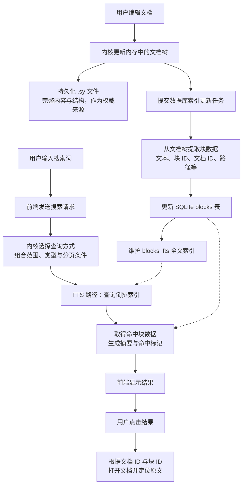
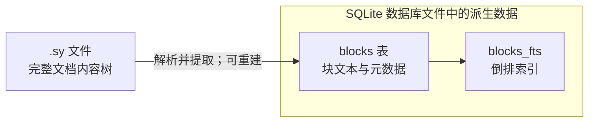

# 04：全文搜索与索引流程

整理：2026-10-15。依据当前仓库静态源码，说明普通笔记的全文检索主线；未进行运行时请求捕获或索引延迟测量。

## 编辑、索引与搜索

下图表达职责与数据流，不规定文件写入和索引任务的精确先后关系，也不表示它们属于一次原子事务。FTS 查询是搜索的一条路径；正则、SQL、部分多关键词查询使用其他分支。

## 文件与数据库分别保存什么

正文文字在原始文档和查询表中存在重复，但表示与职责不同。文件保存完整结构，块表保存便于查询的数据，倒排索引维护词项到记录的对应关系。当前 `blocks_fts` 使用 FTS5 external-content 模式，由 `blocks` 提供字段内容。

这可以类比附件解析：原文件保留，提取文本和元数据后建立索引。类比的是加工职责，不表示思源正文与附件使用相同解析器或更新流程。

正文已保存与搜索索引已更新是不同完成条件。异步更新可能产生搜索可见性延迟；具体入口是否等待索引完成，仍需沿对应调用链核实。

## 实现入口

- [前端搜索](../../app/src/search/util.ts)：输入调度、请求、分页及过期结果检查。
- [搜索 API](../../kernel/api/search.go)：`fullTextSearchBlock` 接收请求。
- [查询模型](../../kernel/model/search.go)：搜索模式分支，`fullTextSearchByFTSInBox` 使用 `MATCH`、`snippet()` 与分页。
- [数据库定义](../../kernel/sql/database.go)：`blocks`、`blocks_fts` 与分词器配置。
- [索引队列](../../kernel/sql/queue.go)、[索引写入](../../kernel/sql/upsert.go)：索引任务与块表、全文索引写入。

对自建方案的启示：文档文件与关系文件可以分别保存原始事实，SQLite 保存可重建的查询数据。关系文件属于原始数据，不能与搜索索引混为一类。
