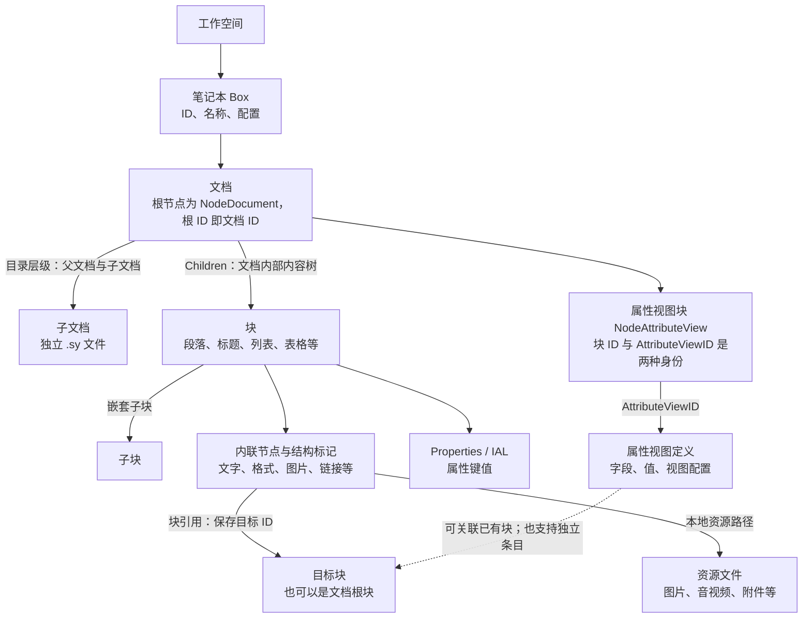
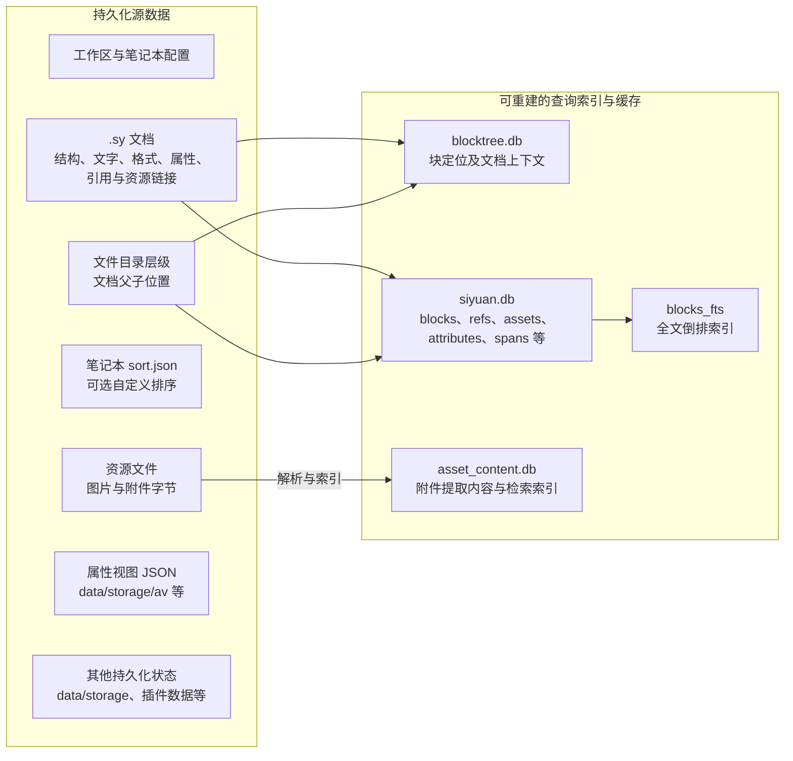

# 05：思源核心数据全景

整理：2026-10-15。依据当前仓库的格式文档、工作区说明与源码静态核对。范围覆盖笔记本、文档内容、引用、资源、属性视图、查询索引与编辑历史；不是全部模块的字段清单，不将此图视为自建系统方案。

## 逻辑对象关系



图中两种包含关系必须分开：父文档与子文档是目录关系；段落、列表等是单篇文档内部的内容树。文档本身是根块，不是与块完全无关的另一种内容身份。不是每个 AST 节点都是块，图片节点属于内联节点；是否为块按节点类型判断，不按有无 ID 判断。

引用关系也不同于包含关系：修改引用不等于移动目标；删除一个引用节点不等于删除目标块。图片或附件引用也不等于资源文件的唯一所有权，同一资源可被多处引用。

## 权威数据与派生查询数据



该图是责任地图，不是所有初始化、缓存更新与文件写入的精确调用顺序。不能把 SQLite 文件一概当成原始正文，也不能把 `data/storage/` 因名称带 storage 或数据库界面而当作可丢弃缓存。索引可重建不代表能够替代原始内容与元数据备份。

普通笔记本的示意目录如下。短 ID 仅用于教学；顶层笔记本文档存在特殊映射，完整规则见工作区说明。

```text
workspace/
├─ conf/conf.json                   工作区配置
├─ data/
│  ├─ notebook-1/
│  │  ├─ .siyuan/conf.json           笔记本配置
│  │  ├─ .siyuan/sort.json           可选自定义文档排序
│  │  ├─ doc-A.sy                    A 的正文
│  │  └─ doc-A/doc-B.sy              B 的正文；B 是 A 的子文档
│  ├─ assets/image-xxx.png           全局图片或附件
│  └─ storage/av/av-ID.json          普通笔记本属性视图定义
├─ history/                         编辑历史归档
├─ repo/                            快照与同步仓库
└─ temp/
   ├─ siyuan.db                     块与关系查询数据、全文索引
   ├─ blocktree.db                  块定位索引
   ├─ asset_content.db              附件内容索引
   └─ history.db                    历史查询索引
```

加密笔记本有密文、隔离索引与本地资源约束：不能直接把上述普通笔记本读取方式套用；见加密笔记本说明。

## 主要查询表

下表是字段分组与职责说明；箭头是语义关联，不声明数据库建立了 SQL 外键。确切字段以建表源码为准。

| 表 | 查询职责 | 关键字段或关联 |
|---|---|---|
| `blocks` | 查询文档根块与其他内容块 | `id`、`root_id`、`parent_id`、`box`、`path`、`hpath`、`type`、`subtype`、`content`、`markdown`、`ial`、`created`、`updated` 等 |
| `blocks_fts` | 全文检索 | FTS5 external-content，列值由 `blocks` 提供，以 SQLite rowid 对应；rowid 不等于业务块 ID |
| `refs` | 正向引用与反向链接查询 | `block_id` 是引用所在块，`def_block_id` 是被引用目标；双方还有所属文档、路径等信息 |
| `assets` | 查询文档中的资源引用信息 | `block_id`、`root_id`、`box`、`docpath`、`path`、`name`、`hash` 等；资源字节不存于此表 |
| `attributes` | 按属性查块 | `name`、`value`、`block_id`、`root_id` 等；不要与属性视图定义混同 |
| `spans` | 查询提取的行内内容 | `block_id`、`root_id`、`content`、`type` 等；不等于完整 AST 的全部内联节点 |
| `file_annotation_refs` | 文件批注引用查询 | `file_path`、`annotation_id`、`block_id` 等 |
| `block_embeddings` | 语义检索派生数据 | 块 ID、向量、模型与生成状态等，不是正文来源 |

## 基础字段的语义边界

| 概念 | 思源中的含义 | 依赖此概念的功能 |
|---|---|---|
| 块身份 | AST 块 `ID`，规范数据同步 `Properties.id` | 引用、定位、编辑、撤销、Agent 操作 |
| 文档身份 | 文档根块 ID，文件名与之对应 | 打开文档、保存粒度、历史 |
| 文档归属 | `root_id`，文档树上下文中的 `Box` | 跨文档移动、查询过滤、索引更新 |
| 父关系 | AST 直接父节点与索引 `parent_id` 要区分；索引可能按标题关系加工 | 结构操作、层级查询 |
| 物理位置与显示位置 | `path` 使用 ID 路径，`hpath` 由标题等派生 | 导航、移动、路径搜索 |
| 节点类型 | `Type` 及类型专属字段；并非只有一段统一文本 | 富文本、导入、图片、HTML、代码与数学内容 |
| 属性扩展 | AST `Properties` / IAL，查询时可提取 | 样式、命名、标签与扩展元数据 |
| 内容与资源 | 节点保存资源链接，资源文件保存字节 | 图片、附件、导入导出、资源清理 |
| 持久化版本与更新时间 | 文档格式版本、`updated` 等各有语义；更新时间不能自动当作并发校验版本 | 兼容读取、变更识别、迁移 |

字段不必全部冗余写入原始文档。例如 `root_id`、`box`、`path` 等可在树上下文与索引中派生，不能将 `sql.Block` 字段表直接复制成每个 AST 节点的存储模型。

## 后续功能怎样接入核心模型

- Markdown 导入：解析外部格式，转换为内部 AST、分配或处理块身份，并处理资源；具体转换链待专题核实。
- 图片与附件：正文节点保留引用，文件保存资源字节；外链图片不要求已有本地资源文件。嵌入 HTML 由对应节点保存内容，iframe 等有独立类型，不等同于图片附件，也不意味着可以安全执行任意 HTML。
- 编辑与撤销：事务操作内容树；当前普通编辑撤销权威记录在内核内存中，重启清空，不是 `history.db` 中的持久撤销表。
- 历史与同步：`history/` 与 `repo/` 承担独立的历史归档和快照职责，不应只靠 `updated` 一个字段推导能力；具体机制后置。
- Agent：通过块身份与业务接口进入操作链，不需要定义另一份独立正文模型。
- 属性视图：是独立领域模型，有字段、值与视图定义，不只是给普通块增加几个属性；具体值类型与关联规则后续按需展开。

## 附件子系统：文件、引用、提取与 OCR

补充静态核实：资源文件命名、引用记录身份和内容指纹是三种不同概念。正文通常保存 `assets/名称-ID.ext` 路径；上传计算内容 ETag/hash 用于查找已有资源与去重。`assets.id` 在提取引用记录时生成，不是跨重建稳定的资源 ID；内容检索记录的 ID 也会在索引时生成，该路径按资源 `path` 删除旧索引并重新插入。

核心关系为 `文档内资源链接 → assets 路径 → 原文件`，查询侧分为“哪些块引用文件”和“文件内有什么文字”。直接覆盖文件内容可以保持路径不变而改变内容指纹，故不能把资源路径与内容 hash 混为一种身份。

附件引用与内容检索直接涉及两张逻辑表：`siyuan.db.assets` 保存引用信息；`asset_content.db.asset_contents_fts_case_insensitive` 同时保存文件元数据、提取文字并维护 FTS 索引，不是额外一张普通 `asset_contents` 表再加一张 FTS 表。FTS 自身的影子表属于 SQLite 实现细节。若计入正文图片的检索还会涉及 `blocks`、`blocks_fts`、`spans`；文件批注另涉及 `file_annotation_refs`。

当前附件解析器注册了纯文本、PDF、DOCX、PPTX、XLSX、EPUB 等格式；未注册类型不会自动获得正文内容检索。图片 OCR 则是另一条路径：通过可用的 Tesseract 处理支持的图片，将资源路径到识别文本的映射保存到 `data/assets/ocr-texts.json`，随后重建相关节点索引。`sql/block.go` 会在提取块内容时读取图片 OCR 文字。因此不能把图片 OCR 一概画成流入附件全文表。OCR 依赖启用状态及大小、类型等限制；当前自动处理会跳过加密资源，不保证全部图片或扫描 PDF 自动可检索。

准确时序：OCR 结果先由 `SetAssetText` 更新内存映射，节点索引可直接读取该映射；`ocr-texts.json` 由独立的保存任务持久化，不是块索引更新的前置条件。当前定时器每 30 秒触发 OCR 作业与 OCR 文本保存任务，识别后对待刷新节点调用 `sql.IndexNodeQueue`，随后由块索引队列更新 `blocks` 和 `blocks_fts`。30 秒是调度间隔，不是搜索可见时限。PDF 等附件走资源变更处理或主动全量重建、格式解析、附件索引队列，最终进入 `asset_contents_fts_case_insensitive`；当前附件解析器注册中没有 PNG/JPG 图片解析器。两条处理链的耗时与搜索入口独立，不能混同为立即完成的正文保存步骤。

## 属性视图子系统：展示入口与行绑定

`NodeAttributeView` 是文档中的一种块类型。它有自身块 ID，并通过 `AttributeViewID` 指向单独保存的属性视图 JSON。普通段落不是必须关联属性视图。

属性视图中的行可以绑定已有内容块，绑定目标由 `ValueBlock.ID` 表达；也支持非绑定条目（`IsDetached`，此时绑定块 ID 可为空）。这两条关系要分开：`属性视图块 → 定义` 是展示入口，`定义中的行 → 普通块` 是条目绑定。普通 `NodeTable` 则是内容树里的表格，不等于属性视图。

## 证据入口

- [工作区布局](../../docs/WORKSPACE.zh-CN.md)、[文档格式](../../docs/SY-FORMAT.zh-CN.md)、[加密笔记本](../../docs/ENCRYPTED-NOTEBOOK.zh-CN.md)。
- [主要表定义](../../kernel/sql/database.go)、[查询块结构](../../kernel/sql/block.go)。
- [文档树读写](../../kernel/filesys/tree.go)、[笔记本模型](../../kernel/model/box.go)。
- [属性视图模型与存储路径](../../kernel/av/av.go)、[内核撤销日志](../../kernel/model/undolog.go)。
- [资源上传与内容指纹](../../kernel/model/upload.go)、[资源引用提取](../../kernel/sql/database.go)、[附件解析与索引](../../kernel/model/asset_content.go)。
- [OCR 处理](../../kernel/model/ocr.go)、[OCR 文本存储](../../kernel/util/ocr.go)、[块检索文本提取](../../kernel/sql/block.go)、[属性视图行值](../../kernel/av/value.go)。

尚未系统拆解全部闪卡、插件、AI 会话与配置字段，也未运行跨模块验证。此图先建立核心身份、关系、内容和存储的全局视野，后续围绕真实功能补充契约。
